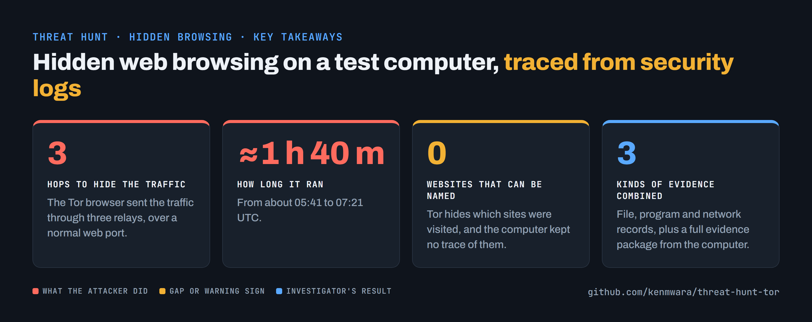

# Threat Hunts

**Four investigations into realistic attacks, each traced from the first sign to the last move and written up as an incident report.**

Threat hunting means searching security logs for an attack that may already be under way, then piecing together what happened and what to do next. Each hunt below was investigated in Microsoft's security tools (Defender and Sentinel) with KQL, Microsoft's log search language. Three were live community hunts on [The Cyber Range](https://www.skool.com/cyber-range), scored on how many investigation questions ("flags") were answered correctly and on time.

| Investigation | What happened | Result |
|---|---|---|
| **[Harborlight](https://github.com/kenmwara/threat-hunt-harborlight)** | Ransomware at a dental practice | 46 / 46 questions · 4,060 of 4,190 points |
| **[Echo Leaks](https://github.com/kenmwara/threat-hunt-echo-leaks)** | Microsoft 365 Copilot tricked by a Word file | 17 / 17 questions · a perfect 1,600 |
| **[Meridian](https://github.com/kenmwara/threat-hunt-meridian)** | A hacked Linux web server | 16 / 16 questions · full marks |
| **[Unauthorized Tor](https://github.com/kenmwara/threat-hunt-tor)** | Hidden browsing on a test computer | Session and relays traced |

## [Harborlight: ransomware at a dental practice](https://github.com/kenmwara/threat-hunt-harborlight)

One phishing download gave an attacker control of the whole network in just over three hours. All 46 investigation questions answered (4,060 of 4,190 points), on time.

[Read the full report →](https://github.com/kenmwara/threat-hunt-harborlight)

## [Echo Leaks: an AI assistant tricked into reading private files](https://github.com/kenmwara/threat-hunt-echo-leaks)

Hidden instructions in a Word file made Microsoft 365 Copilot read 13 confidential files and try to send them out. All 17 questions answered, a perfect 1,600 of 1,600, on time.

[Read the full report →](https://github.com/kenmwara/threat-hunt-echo-leaks)

## [Meridian: a hacked Linux web server](https://github.com/kenmwara/threat-hunt-meridian)

A website flaw leaked a password, the attacker took full control, and a backdoor was still running at the end. All 16 questions answered, full marks, on time.

[Read the full report →](https://github.com/kenmwara/threat-hunt-meridian)

## [Unauthorized Tor browsing on a work computer](https://github.com/kenmwara/threat-hunt-tor)

A hidden browser was used for about 1 hour 40 minutes on a test computer. The session was rebuilt from Microsoft Defender's logs and an evidence package.

[Read the full report →](https://github.com/kenmwara/threat-hunt-tor)

## How each report is written

Every report follows the same incident-report shape: a bottom line first, the key numbers, what happened in order, the evidence behind each finding, the alert rules that would catch it next time (each re-run against the data), and what to do now.

A fifth live hunt closes on 30 October 2026; its report will be added here after it closes.

*Simulated environments only. All data comes from training ranges and lab machines; no real organisation was involved.*
